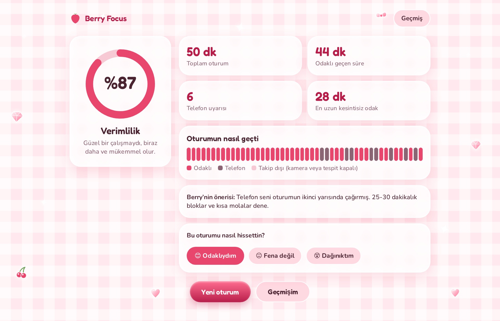
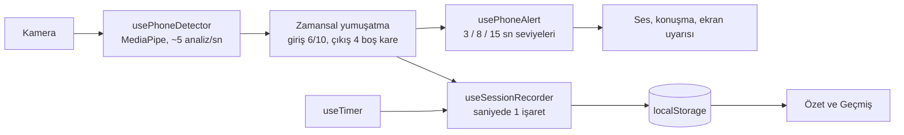

# Berry Focus 🍓

[](https://github.com/zehraeraslan/berry-focus/actions/workflows/ci.yml)

Kamera destekli "benimle çalış" ders çalışma platformu. Süreni seç, çalış. Telefonu eline alırsan Berry seni kademeli olarak uyarır, oturum bitince verimlilik yüzdeni ve kişisel önerilerini görürsün.

**Canlı demo:** https://berry-focus.vercel.app

<!-- Ekran görüntüleri eklendiğinde aşağıdaki satırların başındaki yorum işaretlerini kaldır.


-->

## Özellikler

- **Zamanlayıcı:** 15 / 25 / 45 / 50 / 90 / 120 dakika ya da 1-300 dakika arası elle ayar. Duraklat ve devam et desteklenir, sekme arka plandayken bile sapmaz.
- **Telefon tespiti:** Kamera görüntüsünde telefon aranır, bulununca kutu çizilir.
- **Kademeli uyarı:** Telefon kesintisiz görüldükçe uyarı tırmanır.
- **Gün sonu paneli:** Verimlilik yüzdesi, odaklı süre, uyarı sayısı, en uzun kesintisiz odak ve zaman çizelgesi.
- **Kişisel öneri:** Telefonun oturumun neresinde seni dağıttığına göre kural tabanlı tavsiye.
- **Geçmiş:** Son 7 günün grafiği, günlük seri ve oturum listesi.

### Uyarı seviyeleri

| Telefon kesintisiz görüldü | Uyarı |
| --- | --- |
| 3 sn | Berry'nin baloncuğunda nazik hatırlatma |
| 8 sn | Ekran kenarı kırmızı yanıp söner, zil çalar |
| 15 sn | Tam ekran uyarı, yüksek alarm ve sesli komut |

## Nasıl çalışır?



Birkaç tasarım kararı:

- **Her şey tarayıcıda çalışır.** Sunucu yok; kamera görüntüsü cihazdan çıkmaz ve kaydedilmez. Yalnızca model ve WASM dosyaları internetten indirilir.
- **Zamansal yumuşatma:** Tek karelik yanlış tespitler alarm çaldırmasın diye "telefon var" kararı son 10 analizin en az 6'sına bakar. Uyarıyı kapatmak için ise son 4 analizin boş olması yeterlidir (histerezis), böylece telefon bırakılınca uyarı gecikmez.
- **Zaman damgası tabanlı sayaç ve kayıt:** Süre `Date.now()` farkından hesaplanır; sekme arka plana geçip tarayıcı zamanlayıcıyı yavaşlatsa bile saniyeler kaymaz.
- **Verimlilik** = odaklı saniye ÷ takip edilen saniye. Duraklatılan ve kamera/tespitin kapalı olduğu süreler hesaba katılmaz.

## Teknolojiler

React 18, TypeScript, Vite, MediaPipe Tasks Vision (EfficientDet-Lite0), Web Audio ve Web Speech API, Vitest, GitHub Actions.

## Çalıştırma

```bash
npm install
npm run dev
```

`http://localhost:5173` adresini aç. Kamera yalnızca `localhost` veya HTTPS üzerinde çalışır.

```bash
npm test         # birim testleri
npm run build    # tip kontrolü + üretim derlemesi
```

## Sınırlılıklar

- Hazır genel amaçlı model kullanıldığı için telefon bazı açılarda (ters, kısmen kapalı, loş ışık) kaçırılabilir ya da benzer nesneler telefon sanılabilir.
- Tespit yalnızca sekme açıkken ve kamera aktifken çalışır.
- Oturum geçmişi tarayıcıda tutulur; başka cihazla senkronize edilmez.

## Yol haritası

- [x] Tema, zamanlayıcı ve kamera akışı
- [x] Telefon tespiti ve kademeli uyarılar
- [x] Gerçek oturum verisi, verimlilik ve geçmiş
- [x] Birim testleri ve CI
- [ ] Kadrajda yüz yok ve başı aşağı eğme tespiti
- [ ] Pomodoro molaları ve ambient müzik
- [ ] Kendi topladığım verilerle ince ayarlı model ve karşılaştırma tablosu

## Lisans

MIT
